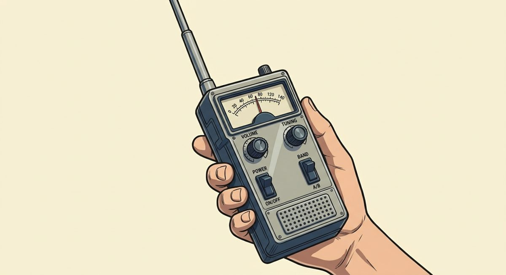

# NIC-Tiros — Ham, the receiver on the ground

**A bought board and software** (`parts.md`, *Ham*): Seeed's XIAO ESP32-S3 & Wio-SX1262 kit — LoRa
at 868 MHz with an antenna socket, Wi-Fi, a cell and its charger, USB; others as well. Copied from the professionals: the
**radiosonde hunters' ESP32 receivers** (rdzTTGOsonde: a LoRa board that hears a sonde, shows it on
its own web page and a map, and leads the hunter to it), **Meshtastic** and **ExpressLRS** (a LoRa
device serving its own page over its own Wi-Fi). **No app:** the phone's or the computer's
browser shows Ham's page (`requirements.md`).

## What Ham does

- **Hears every frame** of its set on both channels (`RADIO.md`), checks the tags, and **writes
  down every frame heard** with its arrival time and signal into a file of its own — what arrived,
  even what was lost by the unit itself.
- **Commands** — Ham 1 alone, the master; Hams 2–4 hear and write down, the backups.
- **Draws the set:** its number and key, at random; gives them on the cable as `TIROS.SET`,
  offered for download on its page, copied onto the unit's disk.
- **Keeps the user's tables** — the profiles, named ("rocket C6", "glider") — sends one whole to a
  unit (`RADIO.md`, 5) and reads it back by its CRC.
- **Reads the boot log** of a unit (LOG_GET) and shows it.

## One page for every system — nothing to install

**Ham's page is the application:** plain HTML and JavaScript over HTTP,
the same on Linux, Windows, macOS, Android and an iPhone, nothing installed, its files free to
download and open. It leans only on what every browser has — Apple's included: a page, a form, a
file chosen and a file saved. **Not used,** since Safari has none of them: Web Bluetooth, WebUSB,
Web Serial. The unit on its cable is a disk, which every system opens, a phone's too.

**The same page opened from a file,** with no Ham at all: it reads a record or Ham's log from the
disk and turns it into CSV, GPX or ULog for the free tools that already exist — the page manages
the units, shows and converts; the analysis is the free tools'.

**The record shown, as an oscilloscope shows it:** a window of the record — 10 s, or any length
from 1 s to the whole — scrolled from side to side; the chosen values drawn over each other in
colours (the acceleration's axes and its magnitude, the rotation, the pressure, …). Each column of
pixels drawn as the lowest and the highest value it covers, the envelope — Audacity's and the
oscilloscopes' peak detect — so a peak of a millisecond shows in half an hour; zoomed in, the
samples themselves. MUF's index (every 200 blocks) lets the page read only the window it shows,
so a long record scrolls as a short one does.

## The page — four views

| view | what it shows |
|---|---|
| **the field** | every unit of the set: its name and number, phase, cell, the last signal both ways, the last fix and its age; ARM, DISARM, START, STOP, OFF |
| **the flight** | the live view: the height from the pressure against the start's, the vertical speed from its change, the acceleration, the roll rate; the events as they come; the position on a map when it is sent |
| **the finding** | below |
| **the unit** | its table of settings, the user's tables to send; its boot log; the set's file to download |

## The finding — as Apple's *Find My* finds a tag

The simplest, after Apple's precision finding: **Ham held under the phone in one hand,** its
antenna — or the arrow drawn on its box — pointing ahead, and one walks.

- **No compass, the signal alone:** as one turns round with Ham, the signal changes — the body
  shading it from behind, the antenna's own null — and the strongest way is the unit's.
- **The arrow,** a plain blunt one, pointing up the screen where Ham's antenna points; **its length
  and colour the signal's strength**, with *near — far* beside it, the number and a tone whose
  pitch rises with it, as the fox hunters' receivers do. One turns until the arrow is longest, and
  walks. Or **the arrow on the map**, marking the unit's last fix. The two to choose between; the
  arrow's shape a setting of the page (a red star with its top point drawn long, should anyone
  insist).
- Near the unit Ham lowers its power step by step (POWER); BEEP for the last metres; PING for a
  quick answer.

**The map,** for getting near — by car, by bike, on foot: **OpenStreetMap and an open
orthophoto**, two layers to switch, their detail following the zoom by themselves as such maps
do; the map library (Leaflet) carried in Ham; every fix received set on it by itself, the last
one marked. The tiles come over the phone's own mobile data — without it, the coordinates alone,
to be copied into any map application (Mapy.cz, …) to navigate by. The orthophoto for Czechia
ČÚZK's, its terms of use to be read.

The height and the vertical speed are Ham's, from the pressures (`RADIO.md`, 2); the unit sends
the barometer's own number.

## The page's lock — as NIC-Strelka's Povodok

Ham's own Wi-Fi network with its own password (WPA2), and the page's **password, at least twelve
characters, checked by a challenge and its answer**, never sent; Ham keeps its SHA-256.

## Open

- The board — when the units are built.
