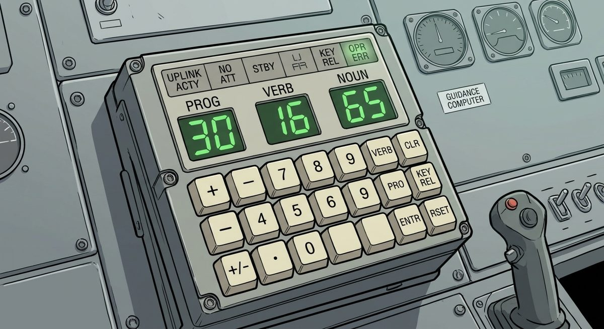

# NIC-Tiros — Hamilton's states (level 6)

The firmware of Baker and Able as a machine of states. **Copied from the professionals:** the
amateur rocketry's flight computers (Altus Metrum's TeleMega: *pad, boost, coast, drogue, main,
landed*), cut to what a unit without charges needs; ArduPilot's and PX4's *land detector* (landed when
still). **One machine, one default table; no profiles built in**: a
profile is the user's own — a table of settings named and kept in Ham ("rocket C6",
"glider", …) and sent to the unit whole (`RADIO.md`, 5); the unit holds one table. Every way of
flying is reached by the settings below, none by a mode. Every threshold is a setting
(`SETTINGS.md`); every change of state is an event in the record (`RECORD.md`, `EVENT`) and the
phase in every radio frame (`RADIO.md`).

## The states

| # | the state | what runs | what it records |
|---|---|---|---|
| — | **off** | nothing: the nPM1300's ship mode, as NIC-Strelka's — 370 nA (nPM1300 PS v1.1); no radio, no listening. Woken by a magnet held to the case (the Hall switch on its SHPHLD pin) or by the cable's 5 V | nothing |
| 0 | **on** | awake, the sensors asleep; the radio listening on channel B for ARM, TABLE_GET, LOG_GET, OFF | nothing |
| 1 | **ready** | the sensors, the GNSS; the live view if `LIVE_READY_HZ`; listening | the ring: the last `PRE_S` seconds in RAM, or at `REC_READY` |
| 2 | **climb** — the flight up to its top, or the whole flight if no top is looked for | everything; the live view | at `REC_CLIMB`, the ring written first |
| 3 | **descent** — after the top | everything; the live view | at `REC_DESC` |
| 4 | **landed** | the GNSS until a fix within `BEACON_ACC_M`, then off; the beacon; the buzzer; listening | at `REC_LANDED`, 0: the file closed |

## The changes

| from | to | when | |
|---|---|---|---|
| off | on | the magnet held to the case, or the cable's 5 V | the boot log's record |
| on | ready | ARM by radio, or at once on waking (`ARM_BY`) | event 1 armed |
| ready | on | DISARM | |
| on, ready, landed | off | OFF by radio, the magnet held 6 s, or `IDLE_OFF_MIN` in on with nothing heard — the ship mode | |
| ready | climb | **a launch:** the acceleration departs from 1 g by `LAUNCH_G` (any axis, any way — a rocket's motor, a plane's run, a hand's throw) for `LAUNCH_MS`, **then confirmed** by the height rising `LAUNCH_UP_M` within `LAUNCH_UP_S`; not confirmed, a bump: still ready. Or START | event 2 launched, **at the step the acceleration first departed** — found in the ring |
| climb | descent | **the top:** the height `APOGEE_M` below its highest | event 3 apogee, at the highest point's step |
| climb, descent | landed | **a landing:** the impact's spike over `LAND_G`, then still — the acceleration near 1 g, the pressure steady — for `LAND_STILL_S` | event 4 landed, at the spike's step (with no spike looked for, the stillness's first) |
| climb, descent | landed | STOP, `SESSION_MAX_S` reached, or the cell empty — the file closed in good order | event 4 landed |
| ready | ready | `SESSION_MAX_S` with no launch: the session given up, the ring dropped | event 17 of the session's end |
| landed | ready | ARM again — a new session, a new file | event 1 armed |
| landed | on | DISARM | |
| on, ready, landed | **the disk** | the cable in: the unit a USB disk, as Strelka's; recording stopped | — |
| climb, descent | — | **the cable never stops a flight** | — |

## The power, the magnet and the light — as NIC-Strelka's

Taken from NIC-Strelka's `FIRMWARE.md` (*The PMIC*, *The magnets and the light*), so that a
Belka and a Tiros are handled alike; one magnet, A, where Strelka's Belka has two.

- **Off is the nPM1300's ship mode,** 370 nA, entered once the cable is out; the magnet held
  96 ms, or the cable, brings the unit back as from power-on. Should the PMIC not take it, the
  processor goes into its own System OFF.
- **The magnet at its mark on the case,** on a Hall switch on the PMIC's SHPHLD (`parts.md`):

| the magnet | what it does |
|---|---|
| off, put on | the board starts; the firmware keeps it on only while the magnet is still there — a magnet brushed past does nothing |
| off, held until the light shows | on |
| on, a short hold | shows the cell's state, as Strelka's |
| on, held 6 s | off when let go: the record closed, the ship mode |
| held 10 s, on or off | the PMIC's own restart, the firmware not asked — the rescue of a unit that hangs in its sealed case; left on, as Strelka's |

- **The cable wakes it but does not switch it on:** it idles on the cable — the disk, the charge,
  the PMIC's green while it charges — the magnet switches it on, and the cable leaving takes an
  idle unit back into ship mode.
- **A restart keeps a unit on** — the watchdog's, a lockup's, an update's — as the reset's cause
  says; only a start from ship mode asks for the magnet or the cable. The boot log keeps why
  (`BOOTLOG.md`).
- **The light, red and green from the PMIC,** Strelka's patterns: a blink of 50 ms every 10 s on
  and waiting; two blinks every 5 s ready or recording; red blinks under 20 %; orange fast blinks
  sought (BEEP); on the cable the PMIC's own — green charging, dark charged, red its fault.
- **The charge and the gauge** as Strelka's: LiFePO4 to 3.50 V; no charge under 0 °C; Nordic's
  fuel gauge, its state kept through the off.
- **The cell empty:** under 3.10 V for 10 s (LiFePO4, as Strelka's Belka) — the record closed,
  its end saying *the cell low*, and **the unit goes off**, as Strelka's: a full cell beacons
  for days, and a unit not found in that time is not saved by its last millivolts.
- **The factory settings** by a file put on the unit's disk on the cable, `TIROS.RST`, taken and
  deleted as `TIROS.SET` is — one magnet has no second for Strelka's two-magnet hold.

**Finding,** in landed: the beacon every 5 s for `BEACON_FAST_MIN`, then every `BEACON_EVERY_S`;
Ham's POWER, BEEP and PING answered (`RADIO.md`); the sliding hour's account kept.

**Every condition is a setting, and 0 switches it off**: a condition
off is not looked for — `LAUNCH_UP_M 0` launches on the acceleration alone, `APOGEE_M 0` has no
descent, `LAND_G 0` lands on stillness alone; all off, a flight starts by START and ends by STOP
or the time. Nothing for rockets, nothing for planes: the same conditions, other numbers.
**The height** from `HEIGHT_BY`: the barometer, the GNSS, or either. **The times are back-dated**:
the 3 s ring holds the moment the acceleration first departed, so the confirmation comes later
and the launch's time is still the true one.

**Where the times go:** the record's event stream (`RECORD.md`, stream 0x13): `EVENT` 2, 3, 4 with
`T_STEP`, the fast stream's step it fell in — one number each, on the record's time line; the
same events in the live view's bits.

## Settings (in `SETTINGS.md`)

| name | default | range | what |
|---|---|---|---|
| `LAUNCH_G` | 1.0 | 0, 0.1–20 g | the acceleration's departure from 1 g that may be a launch … |
| `LAUNCH_MS` | 50 | 10–2000 ms | … held this long … |
| `LAUNCH_UP_M` | 5 | 0, 1–100 m | … confirmed by the height rising this much … |
| `LAUNCH_UP_S` | 10 | 1–120 s | … within this time |
| `APOGEE_M` | 3 | 0, 1–100 m | the top: the height this far below its highest |
| `LAND_G` | 3.0 | 0, 1.1–100 g | the impact's spike … |
| `LAND_STILL_S` | 10 | 0, 2–600 s | … then still this long |
| `HEIGHT_BY` | baro | baro, gnss, either | where the height comes from |
| `IDLE_OFF_MIN` | 10 | 0, 1–1440 min | on, with nothing heard this long: off; 0 never (Strelka's Belka sleeps again after 10 min) |

**Defaults to be argued with:** whoever disagrees changes their own table; a
reasoned remark changes the defaults.
