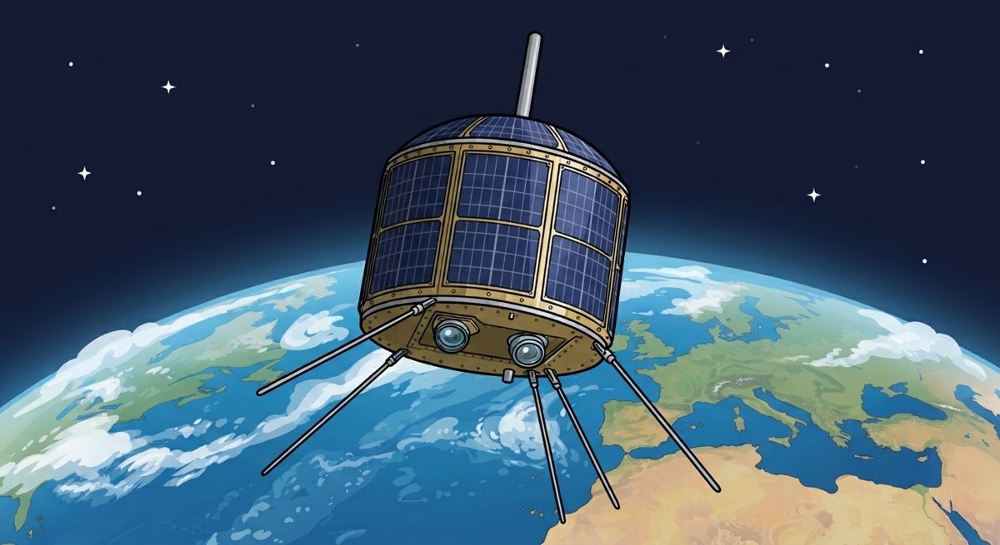

☆ N.I.C. ☆

# NIC-Tiros

**A small unit that records what a model rocket or a model plane goes through — acceleration,
rotation, the magnetic field, the air's pressure, temperature and humidity — sends a live view of
it while it can, and then tells where it is until it is found. Built from ordinary parts, at a
fraction of what such trackers are sold for. It steers nothing.**

> ⚠️ **A concept.** The purpose, the requirements, the architecture, the sums and the parts are
> settled; of the detail, the radio's frames, the settings, the boot log, the firmware's states and
> Ham's page are agreed, the antennas and the contact chosen; no board is drawn
> and nothing is built. The project grows in steps — purpose, requirements, architecture,
> principle, parts, detail — each begun when the one before it is settled.

## The units

| unit | for | what sets it apart |
|---|---|---|
| **Baker** | a model rocket, a body of 20–40 mm | short; its memory soldered beside the processor; a 10440 LiFePO4 cell |
| **Able** | a model plane, a drone, anything that flies long | a microSD card; a larger cell |
| **Ham** | the ground | receives both over LoRa, shows them on a computer or in a phone's browser, and leads you to a lost unit |

 

Baker and Able are the same idea — **a narrow board, the GNSS antenna out of one end, the LoRa
wire out of the other, the contact — a sealed M8 — in an end or on the side, the cell on a connector** — one construction,
**Goddard**, and one firmware, **Hamilton**. Their housings, **Mercury** and **Gemini**, are a
recommendation to the builder, not a drawn box: a cigar, a tin, whatever the model has room for.

## How it works

Every sensor runs on its own clock and is filtered onto one common grid; the whole record is
written at full rate into the unit's own memory, in **MUF** ([`MUF.md`](https://github.com/Project-NIC/NIC-SDK/blob/main/MUF.md)), Project-NIC's record
format — blocks of a sector, each with its CRC, every stream and value described in the file's
head; Tiros's profile in [`RECORD.md`](RECORD.md). The radio carries a live
view in flight and, after landing, the last good position — slowly and robustly — until the unit
is found. Two channels at 868 MHz: the low-power one, free of any duty limit, for everything on
the field; the 500 mW one for the beacon and wherever reach is wanted. A unit is made ready over
the radio and finds its own launch, top and landing; every threshold is a setting, and the whole
table of settings is sent to it at once, only from close by or on the cable. The frames that
command are signed with the set's key, given on the cable and never sent on the air. Every unit
keeps a log of its last 64 starts, so a unit that will not start says why. **Finding it:** the
last fix brings you near, and Ham's whip — its own null, or your body as a shade — leads you the
last metres, a fox hunt. The record leaves over USB, as a disk.

## Files

- [`purpose.md`](purpose.md) — what it does, for whom, how we know it works.
- [`requirements.md`](requirements.md) — what is measured, the ranges, the radio, the power, the
  environment.
- [`architecture.md`](architecture.md) — the blocks, the links, the states of a unit.
- [`principle.md`](principle.md) and [`calc/`](calc/) — the physics and the sums, as scripts; their
  results in `calc/out/`.
- [`parts.md`](parts.md) — the parts against the requirements they meet.
- [`PINS.md`](PINS.md) — the processor's pins, for drawing the board.
- [`MUF.md`](https://github.com/Project-NIC/NIC-SDK/blob/main/MUF.md) and [`RECORD.md`](RECORD.md) — the record format and Tiros's profile in it.
- [`HAMILTON.md`](HAMILTON.md) — the firmware's states and what moves a unit between them.
- [`SETTINGS.md`](SETTINGS.md) — every setting, its default and its range.
- [`RADIO.md`](RADIO.md) — the radio's channels, frames and key, byte by byte.
- [`BOOTLOG.md`](BOOTLOG.md) — the log of the last starts.
- [`firmware/`](firmware/README.md) — Hamilton's core in plain C, tested on a computer: the frames, the settings, the states, the record (`make test`).
- [`HAM.md`](HAM.md) — Ham, the receiver: what it does and its page; [`ham/mockup.html`](ham/mockup.html) the page to click through.
- [`OPTIONS.md`](OPTIONS.md) — the tree of what was chosen and what else was weighed.
- [`WHY.md`](WHY.md) — what was taken in and then left, and why.
- [`tools/check.py`](tools/check.py) — the consistency check: the byte tables, the settings, the
  sums and the links agree; run on every change.

## What it is not

No guidance of any kind: it has no output that steers. Not a weather station.

Software under the MIT licence ([`LICENSE`](LICENSE)); the hardware design under the CERN-OHL-P v2
([`LICENSE-HW`](LICENSE-HW)).

## Acknowledgements

To the AI assistant Claude (Anthropic), for its great help with this project.

☆ Viva La Resistánce ☆
