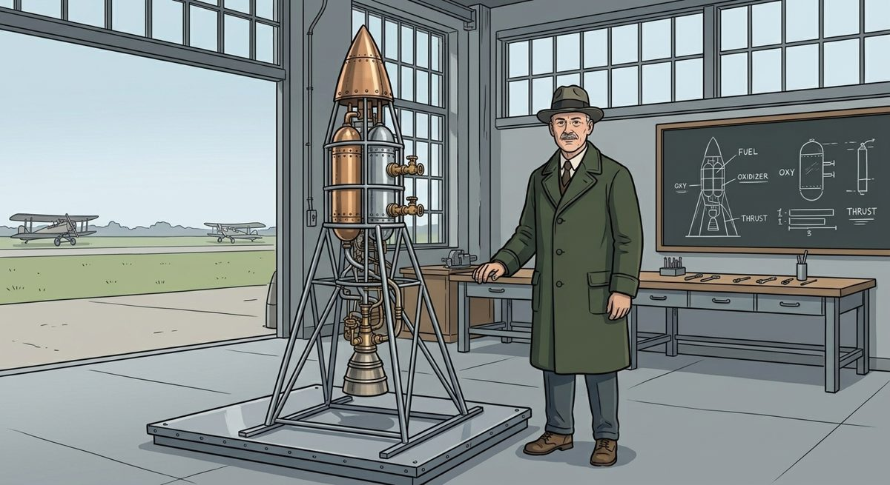

# NIC-Tiros — architecture

The blocks and what talks to what, over what. No part types here; the parts chosen
are in [`parts.md`](parts.md).

## The names

**Goddard** the construction — the boards; **Hamilton** the firmware; **Mercury** Baker's box,
**Gemini** Able's box.

## The three units

- **Baker** — the small one, in a rocket; its log in memory soldered on the board.
- **Able** — the big one, on a plane; its log on a card that can be taken out. Otherwise Baker's
  blocks; the same firmware.
- **Ham** — on the ground: receives Baker and Able, shows them to a computer and a phone.

## Baker and Able: the blocks

| block | what it does | talks to the processor over |
|---|---|---|
| **processor** | reads the sensors, stamps every sample, writes the log, runs the radio, the states | — |
| **power** | the cell, its charging from USB, the rails, the cell's state, the LEDs and the magnet's switch, switching the others off | its own I2C bus + an interrupt |
| **memory** | the whole log at full rate | its own fast SPI bus |
| **motion** | acceleration (low and high range at once) and rotation | its own SPI bus + an interrupt |
| **pressure** | the air's pressure, through a port to the outside | its own I2C bus + an interrupt |
| **field and air** | the magnetic field; the air's humidity and temperature on a probe outside the body | one shared I2C bus |
| **position** | position, date and time; a pulse each second | a UART + the pulse into a timer's capture |
| **radio** | LoRa to Ham: the live view, the position, the commands | its own SPI bus + its busy and interrupt lines |
| **USB** | the log out as a disk; setting up; charging | the processor's USB |

Every sensor runs on its own clock; the processor stamps each sample on its one time axis,
which the position's pulse each second ties to true time. No common sample clock.

## Ham: the blocks

| block | what it does |
|---|---|
| **processor with Wi-Fi** | runs the radio, keeps what arrives, serves a web page |
| **radio** | LoRa to Baker and Able, a socket for an outside antenna |
| **power** | USB, and a cell to be carried out |
| **USB** | to a computer or a phone: a network adapter and a disk — what arrived, setting up, the Wi-Fi given |
| **Wi-Fi** | joins the user's network (the phone's hotspot); the browser shows the page, no app |
| **Bluetooth LE** | the Wi-Fi's name and password given from a phone or a computer |

## The links

| link | between | carries |
|---|---|---|
| **LoRa, 868 MHz** | Baker / Able ↔ Ham | two channels: the live view, commands and setting up on the low-power one; the position after landing on the 500 mW one, slow and robust — [`RADIO.md`](RADIO.md). The unit listens a moment after each packet it sends. |
| **USB** | a unit ↔ a computer | the log as a disk; setting up; charging |
| **USB** | Ham ↔ a computer | what arrived; setting up |
| **Wi-Fi** | Ham ↔ a phone | over the phone's own network, the page: the live view, the position, the commands |
| **Bluetooth LE** | Ham ↔ a phone | the Wi-Fi given once (or the same over USB) |

## The states of a unit

| state | what runs |
|---|---|
| **off** | the power block's ship mode, nothing else; woken by a magnet held to the case or by the cable |
| **on the cable** | USB: the disk, setting up, charging |
| **on** | awake, listening for "make ready" |
| **ready** | the sensors and the position running; the last seconds kept in a ring |
| **climb**, **descent** | full rate into memory; the live view on the radio |
| **landed** | the sensors off; the position slowly, robustly, now and then; listening after each packet |

Set out in detail in [`HAMILTON.md`](HAMILTON.md): **the launch, the top and the
landing** are found by the unit itself, each by conditions that are settings, the radio's START
and STOP beside them (a change made there, [`WHY.md`](WHY.md)).

## Not here

The rates, the sizes, the energy — [`principle.md`](principle.md) and [`calc/`](calc/), as scripts.
The parts — [`parts.md`](parts.md). The pins, the frames byte by byte — [`PINS.md`](PINS.md),
[`RADIO.md`](RADIO.md) and the rest, every frame set out as a byte table.
